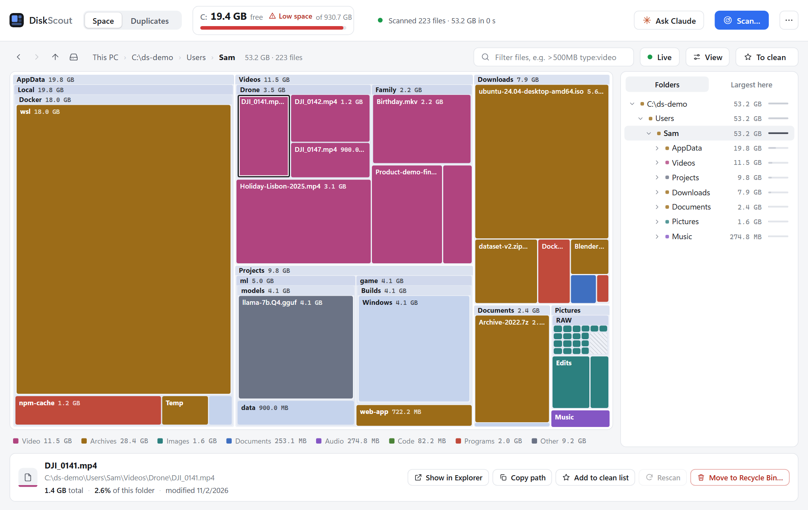

# DiskScout

See where your disk space went, and find duplicate files by content. **One portable `.exe` (about 8 MB) for Windows 10 and 11**:
no installer, no dependencies, no telemetry. It never freezes while it scans, it explains the space it cannot see, and, if you
use [Claude Code](https://www.anthropic.com/claude-code), Claude can help you decide what to clean, without ever being able to
delete anything on its own.

Built as the SpaceSniffer-style treemap many people recommend, for a Windows that has changed since.

> **Status:** young. It has been run against real disks, and the test suite exercises the safety rules below against real
> files. Expect rough edges in the polish; please tell us when you find any. Issues and pull requests are welcome.

<picture>
  <source media="(prefers-color-scheme: dark)" srcset="docs/screenshot-dark.png">
  
</picture>

*The screenshots show a made-up demo disk, not a real one.*

## Get it

Prebuilt exes are attached to each [release](https://github.com/agentruntime-io/diskscout/releases): download `DiskScout-<version>.exe` and run it.
The exe is unsigned, so Windows SmartScreen may warn the first time ("More info" > "Run anyway"). Or build it yourself in one
command (see [Building](#building)). It makes no network connections of its own: it only talks to its own window over
`127.0.0.1`.

## What you get

**Space** is a treemap that fills in *while* it scans, so you can start exploring at once.
- **Clean cuts.** The window is greys and one blue; the colour is in the data. Files, and folders drawn as one piece, are
  solid blocks in the colour of their kind (video magenta, archives mustard, images teal, documents blue, audio violet,
  code green, programs brick red) with a white label. A folder drawn as one piece takes the colour of what is mostly inside
  it (60% or more of one kind) and is slate when it is mixed. Folders that show what is inside them are dark panels with a
  header strip, and Windows' own files are grey. The drive
  tile at the top shows where the space went in one strip. Every block is labelled, and the legend under the map filters by kind.
- **The legend is a real filter.** Pick a kind under the map (Video, Images, Documents, ...) and the map shows only those
  files, with every folder sized by the files of that kind inside it, so it works at any level, not only where single files
  are drawn. Each kind says how much of it is in the folder you are looking at. Click it again to show everything. It
  combines with the filter box.
- **Live** (the button next to View). The folder you have open keeps itself up to date: Windows tells the app when something
  under it changes, and a moment after things go quiet that folder is read again, the same refresh as the Rescan button. Only
  the open folder is followed (a whole drive changes too often to follow), refreshes slow down on busy folders, and it turns
  itself off, saying so, if reading a folder again turns out to be heavy. Switching it on catches up on whatever changed while
  it was off. Off, **Rescan** still refreshes a folder by hand. The choice is remembered.
- Light and dark themes follow Windows.
- Folders nest as deep as the pixels allow, each with a slim header (`name - size`), like SpaceSniffer. A folder only opens
  up when its header is a small part of it; smaller ones stay one solid block so the boxes keep their size. Double-click a
  folder to open it, a file to show it in Explorer, right-click for more.
- A **folder tree** on the right: expand, collapse, walk it with the arrow keys. Back / forward / up / home buttons
  (Alt+Left, Alt+Right, Backspace).
- **The map adds up to the drive.** Under **View** you can show or hide:
  - **System-managed** items: the Recycle Bin, `pagefile.sys`, `hiberfil.sys`, System Volume Information, recovery.
    (Windows' *System* attribute. Normal hidden folders like AppData stay visible.)
  - **Free space** (green).
  - **Unaccounted** space: what Windows counts as used but the scan could not see (shadow copies, protected system areas,
    folders you told it to skip). Shown once the drive's scan is complete.
- The **Recycle Bin is shown**, and can be emptied from the map. Moving something to the bin frees no space, so it appears
  in the bin's block instead of vanishing.
- A **filter box**: `*.mov|*.mp4  >500MB  <30d  >1y  type:video  dup  -node_modules` (all terms must match). Folders are sized
  by what matches inside them.
- A real **progress percentage** with time left for whole-drive scans (measured against what Windows says is used).
- A **to-clean list** (press T on anything). Nothing leaves your disk until you press the button, and it only goes to the
  Recycle Bin.

**Duplicates** finds files with identical content, biggest first. Each group suggests one copy to KEEP. Every duplicate is
put in a **category** (Downloads, Temp, Dev & build output, App data, other user accounts, your own files) with a
plain-language definition and a risk level. Open **Category definitions** and edit the rules to suit you.

**By folder** (the switch above the list) finds whole folders that overlap: "folder A has 690 files, 297 of them have an
identical twin in folder B, which has 368". Each pair shows how much of each side is shared, and **Show the proof** lists
every matched pair (the names can differ) and what is only in A and only in B. Every match is a group the scan confirmed by
hashing the full contents of both files. **Select A's / B's copies** ticks one whole side, ready for the usual delete.
The per-folder totals come from a scan run in this window; a saved report has the matches but not the totals.

**Zips** lists each `.zip` that was also unpacked into a folder (found beside the zip, or wherever its biggest files turn up).
A zip lists every file inside it, so the question has an exact answer, and **Compare contents** gives it by reading both:
each file in the zip is unpacked in memory and compared, byte for byte, with the file at the matching path; and the folder is
walked for anything the zip does not hold. You get one of these, in words: *identical*; *everything in the zip is in the
folder, and the folder also holds N other files*; or *not everything in the zip is in the folder: N missing, N different*,
with the names. What cannot be told is said: a zip that will not open or an entry that fails its checksum; a zip unpacked in
among other files, so what else belongs there is unknowable; and RAR, 7z and tar, which DiskScout cannot open (they are
listed with their folder but never compared). The zip may be moved to the Recycle Bin only when everything in it is in the
folder, the folder only when everything in it is in the zip, and the comparison is run again just before anything moves.

With many zips, **Compare all** reads them in the background (two at a time, biggest first, with a Stop button), and the top
of the list sorts them into **Safe to remove** (with the GB they would free), **Not the same**, **Not compared yet** and
**Cannot compare**; click one to filter. **Move the N safe zips to the Recycle Bin** moves them in one go, comparing each
again just before it moves and leaving alone any that no longer match. Only the zips move, never the folders. What was
compared is remembered (until the zip changes), so the window and Claude always see the same results.

**Live**: free space per drive updates by itself. Scans run in the background, so the window never freezes. Files deleted
outside the app are noticed when you switch back to it.

## Claude

Claude can help work out what to delete, and use the app. Three ways, one set of tools:

| | How |
|---|---|
| **Ask Claude** button | A chat panel in the window. It runs your own Claude Code (`claude`), so there is nothing to set up. It can only use DiskScout's tools: no files and no shell. It can run a few command-line tools, but only the way described under *Commands* below. |
| **Claude Desktop** | ⋯ menu > *Connect Claude* > *Connect to Claude Desktop*. Then restart Desktop (quit it from the tray). |
| **Claude Code in a terminal** | ⋯ menu > *Connect Claude* > *Connect to Claude Code*, or by hand: `claude mcp add --scope user diskscout -- "C:\path\DiskScout.exe" --mcp` |

Desktop and the terminal start `DiskScout.exe --mcp`, a small bridge that starts the DiskScout window if it is not running.
(Move the exe? Press Connect again.)

In the chat panel, Claude's answers show real tables, file and folder names as links (click: show in Explorer, Shift+click:
show on the map) and sizes coloured by how big they are. The ↔ button widens the panel for big tables. The chat remembers
the conversation: if Claude has to restart (you pressed **Stop**, or it ended on its own), the new one is handed the
conversation so far along with your next message, so "continue" carries on. **New chat** forgets it, and closing the window
does too: nothing is saved to disk. The chat works with older versions of Claude Code too: it leaves out the flags yours does not know, and refuses to
start one that cannot be kept to DiskScout's tools (update it with `claude update`). A very old Claude Code also asks for models
that have since been retired, and Anthropic's API answers with a 404; the chat explains that in plain words and shows it once. Claude's own scans
build the map only; it asks before hashing file contents for duplicates, and its scans never change your saved scan settings.

What Claude can do: see the scan state and free space; browse the map; list the biggest files; list and filter duplicate
groups and their categories; list the zips that were unpacked into folders, with what has been compared, and check one against
its folder (read-only, byte for byte, so it can say "the same" without guessing); start a scan and wait for it; move your window to what it is talking about; add items to your
to-clean list with a reason; ask to move items to the Recycle Bin; look inside things the map cannot see by running a
command (see below).

**What Claude cannot do: delete on its own.** A request to remove anything waits in your window until you press **Approve**
(there is a "don't ask again until I close this window" tick), and it only ever goes to the Recycle Bin. Claude never gets
permanent delete, never empties the bin, and cannot touch Windows, Program Files or profile folders. Every approved removal is
in `deleted.log` marked `"by":"Claude"`.

### Commands (Docker, WSL, tool caches)

Some of the biggest space hogs are invisible to a file scan: Docker's disk image, WSL, package caches. For those Claude has
one tool, `run_command`. It is **not a shell**: Claude gives a program and its arguments, one command per call, so nothing
can be chained with `&&` or `|`, and every command is started directly with a time limit and capped output.

| Kind | Examples | What happens |
|---|---|---|
| **Look** (a known read-only diagnostic) | `docker system df -v`, `docker images`, `wsl -l -v`, `go env GOCACHE`, `powercfg /a`, `vssadmin list shadowstorage` | Runs at once. A toast tells you it ran. |
| **Cleanup** (a known command that deletes) | `docker system prune`, `docker builder prune`, `go clean -cache`, `npm cache clean --force`, `uv cache clean`, `powercfg /hibernate off` | **Waits in your window** with the exact command line and what it removes. Nothing runs until you press **Run it**. |
| **Anything else** | any other program | Waits for you too, with a warning that it could do anything. |

A command counts as a plain "look" only if nothing rides along: `docker system df extra` or `go env -w ...` already needs
your approval. There is no "don't ask again" for commands, and an approval is for that one command line. Every command,
approved or not, is appended to `commands.log` in the data folder (`"by":"Claude"`, class, exit code).

Note that Docker's disk image (`docker_data.vhdx`) does not shrink by itself after a prune: the space comes back to Windows
only when the image is compacted (for example `wsl --manage <distro> --set-sparse true`, or *Optimize-VHD* from an
administrator PowerShell).

## Using it

Run `DiskScout.exe`. It opens its own window (an Edge or Chrome "app" window, no tabs or address bar) and quits when you
close it. Click **Scan…** and carry on using the window while it runs.

Settings, the hash cache, your category edits and the deletion log live in `diskscout-data` next to the program (or in
`%LOCALAPPDATA%\DiskScout` if that folder is not writable), so the whole thing is portable.

The ⋯ menu can open a saved `duplicates.json` report, so earlier results are usable without scanning again (the format is read in `report.go`; it comes from the small Python script this project grew out of).

Options: `--import <duplicates.json or folder>`, `--data <folder>`, `--browser` (default browser instead of an app window),
`--no-window` (print the address), `--mcp` (run as an MCP server on stdin/stdout), `--version`.

## Safety

- Scanning only reads. It skips symlinks, junctions and cloud placeholders (OneDrive etc.), and runs at below-normal priority.
- It only touches files it listed. A duplicate is deleted only while it is still exactly what the scan saw (same size and
  modified time), and the last remaining copy is never removed unless you tick the box that says so.
- **The copy that stays is checked, not assumed.** Just before a duplicate is removed, both it and a surviving copy are read
  again in full and compared byte for byte. If they differ, or the copy that stays cannot be read (a bad sector, a locked
  file), that duplicate is left alone and the reason is shown. `deleted.log` records which copy each one was proven
  identical to. The delete dialog has a "Skip that check" box for very large files; Claude's deletes always run the check.
  This protects against a copy that went bad after the scan. It is not a backup: once only one copy is left, only one
  copy is left.
- Duplicates can go to the **Recycle Bin** (default) or be deleted permanently (you must type DELETE). Items you delete from
  the map or the to-clean list go to the Recycle Bin only. Drives, Windows, Program Files, ProgramData and profile folders
  cannot be deleted from the map.
- Emptying the Recycle Bin asks first and says it cannot be undone.
- Commands Claude wants to run follow the table above: diagnostics run, everything else waits for your **Run it**.
  If Claude gives up waiting (or you do not answer within 10 minutes) the request is withdrawn and nothing is done.
- Hardlinked names count as one copy, because deleting one frees nothing.
- The window talks to the app over `127.0.0.1` only, with a random token per run.

## Building

Needs Go 1.25 and nothing else (there are no third-party modules). Windows only: it uses Windows APIs for drives, the Recycle
Bin, change notifications and file attributes.

    go test ./...
    go build -trimpath -ldflags "-s -w -H windowsgui -X main.version=1.2.3" -o DiskScout.exe .

The tests run against real files on disk (hardlinks, junctions, system attributes, deletes, the HTTP layer, the live event
stream, change notifications, the MCP protocol, the approval step, a stand-in `claude`). `DISKSCOUT_TEST_RECYCLE=1 go test -run
TestTrashPathGuards` also sends a throwaway file to the real Recycle Bin.

To work on the window, serve its files from disk instead of the embedded copy and reload the page after each edit:

    DiskScout.exe --no-window --ui-dir ui --data %TEMP%\ds-dev

## How it is put together

One Go package (`package main`, standard library only) with the window's files embedded (`ui/`: plain HTML, CSS and JavaScript,
no build step). The exe starts a small HTTP server on `127.0.0.1`, opens an Edge or Chrome app window on it, and quits when the
window closes.

| File | What it does |
|---|---|
| `main.go` | flags, starting the server, opening the window |
| `tree.go`, `view.go` | the scanner and the in-memory tree; what the map shows for a folder (`type:` filters, kind totals) |
| `dupes.go` | the duplicate search: size, then the head and tail of the file, then a full SHA-256, with a hash cache |
| `actions.go` | everything that changes the disk, behind the same guards (see Safety) |
| `archives.go` | zips against the folders they were unpacked into, byte for byte |
| `folders.go`, `watch.go` | what the duplicate search saw per folder; live updating (`ReadDirectoryChangesW`) |
| `categories.go`, `filter.go` | the category rules; the filter box language |
| `server.go`, `state.go`, `report.go` | the HTTP/SSE API, app state and settings, saved reports |
| `mcp.go`, `claude.go`, `chat.go`, `commands.go`, `connect.go` | the Claude side: MCP tools, the approval step, the chat panel, `run_command`, connecting Claude Desktop / Claude Code |
| `winapi.go`, `fsutil.go` | the few Win32 calls; path helpers |
| `ui/` | `index.html`, `app.css`, `app.js` |

## Contributing

Please read [CONTRIBUTING.md](CONTRIBUTING.md). The short version: keep it standard-library only, keep deletes behind the guards
(and add a test for any new way of touching the disk), say plainly what the app cannot tell, and keep the window calm.

## Security

See [SECURITY.md](SECURITY.md) to report a vulnerability privately.

## License

[MIT](LICENSE). Free to use, change and share.

DiskScout is a community project from [AgentRuntime](https://agentruntime.io).
