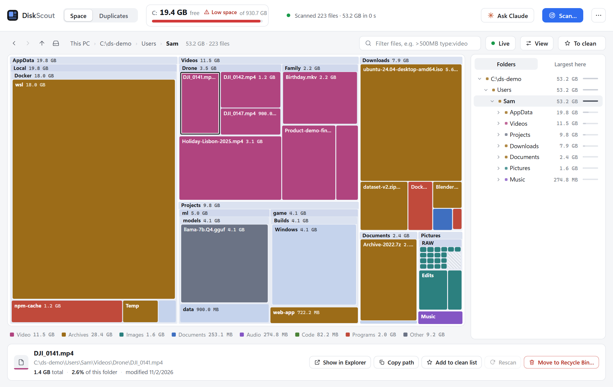

# DiskScout user guide

This guide is for using DiskScout. (The [README](../README.md) is the reference, and how it is built.) It assumes nothing:
if you can run a program on Windows, you can follow it.

- [Start it](#start-it)
- [Updating](#updating)
- [Your first scan](#your-first-scan)
- [Reading the map](#reading-the-map)
- [Finding what is big](#finding-what-is-big)
- [Freeing space safely](#freeing-space-safely)
- [Duplicates](#duplicates)
- [Zips and the folders they were unpacked into](#zips-and-the-folders-they-were-unpacked-into)
- [Ask Claude (optional)](#ask-claude-optional)
- [Your data, and what is sent where](#your-data-and-what-is-sent-where)
- [When something goes wrong](#when-something-goes-wrong)
- [Shortcuts and command line](#shortcuts-and-command-line)

## Start it

Download `DiskScout-<version>.exe` from the [Releases](https://github.com/agentruntime-io/diskscout/releases) page and
double-click it. There is nothing to install: it is one file. Put it anywhere (a folder of your own is best, because it keeps
its settings next to itself).

- **Windows may warn you the first time** ("Windows protected your PC"). The program is not code-signed. Choose *More info*,
  then *Run anyway*. If you would rather not trust a download, you can build it yourself from the source in a minute (see the
  README).
- It opens its own window (an Edge or Chrome "app" window, with no tabs or address bar), and it quits when you close that
  window. If neither browser is installed it opens your default browser instead; then stop it with **⋯ > Quit DiskScout**.

## Updating

DiskScout never updates itself, and never checks on its own. To find out whether there is a newer version, open **⋯ > Check
for updates…**. It asks GitHub for the number of the newest release and tells you the answer; if there is a newer one, it
offers to open the download page. It does not download or install anything.

To update:

1. Download the new `DiskScout-<version>.exe` from the [Releases](https://github.com/agentruntime-io/diskscout/releases) page.
2. Close DiskScout, then run the new file **from the same folder** as the old one. Your settings, the hash cache and the
   deletion log live in the `diskscout-data` folder next to the program, so they carry on. (Running it from a different
   folder starts fresh, unless you copy that folder across.)
3. If you connected Claude Desktop or Claude Code, press **Connect** again from the new file. It remembers where the program
   is, and the file name changes with the version. Delete the old exe when you are happy with the new one.

## Your first scan

Click **Scan…** (top right, or the big button in the empty window). A dialog opens:

- **Folders to scan**: one per line. The three buttons above the box fill it in for you: *All drives*, *My user folder*, or
  *Downloads*. For a first look, *My user folder* is quick and usually where the space is. *All drives* shows everything.
- **Also look for duplicate files**: tick this to find files with identical content. It reads the contents of files, so it takes
  longer (minutes for a big disk, and it works the disk hard). Leave it off for a quick map and turn it on later.
- **Ignore files smaller than** (default 1 MB): files below this size are not looked at for duplicates.
- **Don't look for duplicates in**: Windows and Program Files are skipped by default, because their duplicates are how Windows
  and your programs are built, and deleting them breaks things. They still appear on the map.
- **Never look inside**: folders you want left out of everything (not counted anywhere, so the map will not add up to the
  drive; the *Unaccounted* block explains the difference).

Press **Start scan**. You do not have to wait: the map fills in while it reads, and you can already click around. A whole
drive usually takes a minute or two.

Scanning only reads. Nothing on your disk changes.

## Reading the map

*(A made-up demo disk.)* **The bigger the block, the more space it takes.**

**Colour is the kind of file**, and the legend under the map says which is which and how much of each is in the folder you are
looking at: video, archives and disk images, images, documents, audio, code and data, programs and libraries, other.

**What a block is:**

| You see | It means |
|---|---|
| A dark **panel with a header** (`name  size`) | A folder, with what is inside it drawn in it. |
| A **solid coloured block** | A file, or a folder drawn as one piece. A folder takes the colour of what it mostly holds (60% or more of one kind). |
| A **slate-blue** block | A folder drawn as one piece that holds a mix. |
| A **grey** block with a small gear | Something Windows manages itself: the Recycle Bin, `pagefile.sys`, `hiberfil.sys`, System Volume Information. |
| A **dashed outline** | Free space on the drive. |
| A **hatched** block | Lots of small things lumped together: *files under 1 MB*, *small folders*, or *+N more*. |

**Why are small files not drawn?** The map names files of 1 MB and up, and adds the rest up into the hatched blocks. The totals
still include them.

**Moving around:**

- **Click** a block to select it. The bar at the bottom shows its path, size, how much of the folder it is, and when it changed,
  with buttons for *Show in Explorer*, *Copy path*, *Add to clean list*, *Rescan* and *Move to Recycle Bin…*.
- **Double-click** a folder to open it; double-click a file to show it in Explorer.
- **Right-click** for the same actions as a menu.
- The **folder tree** on the right (*Folders*) opens and closes folders. *Largest here* lists the biggest items in the folder you
  are in.
- **Back, forward, up** and the **all drives** button are at the top left, and the path you are in is shown as clickable
  pieces.

**The map adds up to your drive.** Under **View** you can show or hide:

- **System-managed** items (the list above).
- **Free space**, so the whole drive adds up.
- **Unaccounted**: space Windows counts as used that the scan could not see (shadow copies, protected system areas, folders you
  told it to skip). It appears once a drive has been fully scanned.
- **Highlight duplicates**: dim everything except files that have an identical copy somewhere.

## Finding what is big

- **Click a kind in the legend** (for example *Video*) to show **only those files**, with every folder sized by the video inside
  it. Click it again to show everything. It works at any level, and the number next to each kind tells you where to look.
- **The filter box** narrows by name, size, age and kind. Terms are separated by spaces and all must match:

  | Type this | To see |
  |---|---|
  | `>500MB` | files over 500 MB |
  | `*.mov\|*.mp4` | names ending in .mov or .mp4 (`\|` means "or") |
  | `<30d` | changed in the last 30 days |
  | `>1y` | not touched for over a year |
  | `type:video` | one kind (video, audio, image, archive, doc, code, exe, other) |
  | `dup` | only files that have an identical copy elsewhere |
  | `-node_modules` | leave out anything with that in its path |
  | `>1GB >1y type:video` | big, old videos |

- **Live** (the green-dot button next to *View*) keeps the folder you have open up to date by itself: when files in it change,
  the map follows a moment later. It follows only the folder you have open, never a whole drive. Switch it off if you like; **Rescan**
  (bottom bar, or right-click a folder) refreshes by hand.

## Freeing space safely

A reasonable order:

1. **Look before you cut.** Open the biggest folders. Use the legend to see where your video, archives or disk images are.
2. **Things you can get back are the safest to remove:** installers and zips in *Downloads*, caches, build folders, old
   downloads you can fetch again.
3. **Duplicates** next (see below). Start with the categories marked low risk.
4. **Remember that the Recycle Bin frees nothing.** Moving something to the Recycle Bin does not give the space back until the
   bin is emptied. The map shows the bin as its own block, so you can see it. Select it and choose *Empty Recycle Bin…* when you
   are sure (DiskScout asks first, and says it cannot be undone).
5. **Docker, WSL and tool caches** are invisible to a file scan. Ask Claude (below): it can look inside with read-only commands
   and, with your approval, run the cleanup.

**The to-clean list.** Press **T** on anything you select (or use *Add to clean list*) to put it on your list. The **To clean**
button shows it. Nothing leaves your disk until you press the button there, and it only ever goes to the Recycle Bin.

**Your call, your risk.** DiskScout is free software provided as is, with no warranty (see the
[disclaimer](../README.md#disclaimer)). It is built to be careful, but it is not a backup, so keep a copy of anything you
cannot replace before you clear space.

## Duplicates

Open the **Duplicates** tab. DiskScout finds files with identical content (by size, then the start and end of each file, then
a full SHA-256 of the whole thing), so two files with different names but the same bytes are found, and two with the same name
but different bytes are not. It tells you the space you could get back, in groups, biggest first.

At the top, **By file**, **By folder** and **Zips** are three ways of looking at the same disk.

### By file

Each card is one file that exists more than once. One copy is marked **KEEP** (the suggestion: a copy in one of your *Preferred
folders*, otherwise the oldest, otherwise the shortest path). That is only a suggestion; you can keep any.

- Every duplicate has a **category** (Downloads, Temp folders, Dev & build output, App data and installed apps, Other user
  accounts, Other files) and a **risk**: *low* is usually safe, *medium* means check first, *high* means leave it alone unless
  you are sure, *review* means they are your own files, so it is your call. **Category definitions…** shows what each means and
  lets you change the rules.
- **Preferred folders…** tells DiskScout which folders hold the copy you want to keep.
- Tick the files to remove, or press **Select duplicates in view** (ticks every copy except KEEP in the groups shown), then
  **Delete selected…**. Use the category and location chips and the search box to narrow what "in view" means.
- If you tick every copy of a file, the group is flagged, and DiskScout will not remove the last copy unless you tick a box that
  says you understand.

**What happens when you delete:**

- The default is **Move to the Recycle Bin**. *Delete permanently* needs you to type `DELETE`.
- Just before each file is removed, DiskScout **reads it again and compares it, byte for byte, with a copy that stays.** If they
  differ, or the copy that stays cannot be read, that file is left alone and the reason is shown. There is a *Skip that check* box for
  very large files, but it is not recommended.
- A file is only removed while it is still exactly what the scan saw. If it changed since, it is left alone.
- Every deletion is written to `deleted.log` (see below), including which copy it was proven identical to.

This does not make a backup. When one copy is left, one copy is left.

### By folder

Finds whole folders that overlap: for example, "folder A has 690 files and 297 of them have an identical twin in folder B,
which has 368". Each pair shows how much of each folder is shared. **Show the proof** lists every matching pair and what is only
in A and only in B. **Select A's copies** and **Select B's copies** tick one whole side, ready for *Delete selected…*.

The per-folder totals need a scan run in this window. A saved report has the matches but not the totals.

## Zips and the folders they were unpacked into

If you have a `.zip` and also the folder you unpacked it into, one of them is probably redundant. The **Zips** view finds those
pairs and answers exactly:

- Press **Compare contents** on a zip: each file in it is unpacked in memory and compared, byte for byte, with the file in the
  folder, and the folder is checked for anything the zip does not hold. You get one plain answer: *identical*; *everything in the
  zip is in the folder (and the folder also has N other files)*; or *not everything in the zip is in the folder*, with the names.
- With many zips, **Compare all** does them in the background (biggest first, with a Stop button), and the top of the list sorts
  them into **Safe to remove**, **Not the same**, **Not compared yet** and **Cannot compare**. Click one to filter.
- **Safe to remove** means everything in the zip is also in its folder, byte for byte. **Move the N safe zips to the Recycle
  Bin** does them in one go. Each is compared again just before it moves, and any that no longer match are left alone. Only the zips
  move, never the folders.
- A zip may go only if everything in it is in the folder; the folder may go only if everything in it is in the zip.

**What it cannot tell, it says:** a zip that will not open or an entry that fails its checksum; a zip unpacked among other files
(so what else belongs there is unknowable); and `.rar`, `.7z` and `.tar` archives, which DiskScout cannot open (they are listed next
to their folder but never compared).

## Ask Claude (optional)

The **Ask Claude** button opens a chat panel. It runs **your own Claude Code** (the `claude` program), so you need it installed
and signed in on this computer (run `claude` once in a terminal and follow the sign-in). If it is missing, the panel says so.

Claude can look at your map and your duplicates, list the biggest files, tell you what zips are safe, point at things in the
window, put suggestions on your to-clean list, and, for things a file scan cannot see (Docker, WSL, tool caches), run a command.
Try the suggestion chips under the box, or ask in your own words ("what is using the most space in my user folder?").

**What it cannot do: delete anything on its own.**

- Anything that removes something waits in your window until you press **Approve**, and it only ever goes to the Recycle Bin.
  Claude cannot empty the bin, delete permanently, or touch Windows, Program Files or profile folders.
- It has no file or shell access of its own. For commands it has one tool, `run_command`: a program and its arguments, nothing
  chained. A known read-only look (`docker system df -v`, `wsl -l -v`, …) runs at once. A cleanup (`docker system prune`,
  `go clean -cache`, …) and anything else **waits for you to press Run it**, with the exact command shown.

**Claude can be wrong.** Its suggestions are only suggestions. Read what you are asked to approve, and remember that you, not
Claude and not DiskScout, decide what is removed. Neither AgentRuntime nor the contributors are responsible for changes made
with AI's help (see the [disclaimer](../README.md#disclaimer)).

**Good to know:** **Stop** ends Claude's work; your next message carries on with the conversation so far. **New chat** forgets it,
and closing the window does too (nothing is saved). A very old Claude Code may not work: DiskScout says so, and `claude update`
fixes it.

**Connect…** (in the ⋯ menu) is only for using DiskScout's tools from *somewhere else*, and you do not need it for the panel:
*Claude Desktop* is for the regular Claude chat window; *Claude Code* is for terminal sessions and the Code tab of the Claude
desktop app. If you connect, press Connect from the copy of `DiskScout.exe` you will keep: it remembers where that file is.

## Your data, and what is sent where

**DiskScout sends nothing about you or your files anywhere.** It has no telemetry, and it only talks to its own window on your
own computer, with one exception that you start yourself: **Check for updates** (⋯ menu) asks GitHub for the number of the
newest release. GitHub sees your IP address, like any website you visit, and a request that says "DiskScout" and its version.
Nothing else is sent, nothing is downloaded, and it never runs by itself.

**If you use Ask Claude, or connect Claude Desktop or Claude Code, then what Claude is shown goes to Claude** under your own
account and its terms: folder and file names and paths, sizes and dates, duplicate groups, and the output of the commands it
runs. **File contents are not sent.**

**Where DiskScout keeps its files:** a folder called `diskscout-data` next to the program (or `%LOCALAPPDATA%\DiskScout` if
that folder cannot be written to), so the whole thing is portable:

| File | What it is |
|---|---|
| `settings.json` | what you chose in the scan dialog, and how you like the window |
| `hashcache.tsv` | fingerprints of files already read, so a second duplicate scan is much faster |
| `deleted.log` | a record of everything removed, with the time, the path, and which copy it was proven identical to |
| `commands.log` | every command Claude ran or was asked to run, and whether you approved it |
| `diskscout.log`, `connection.json` | the app's own log, and how a connected Claude finds the running window |

To start fresh, close DiskScout and delete that folder. Your own files are never in it.

## When something goes wrong

| What you see | What it means, and what to do |
|---|---|
| Windows says "Windows protected your PC" | The program is not code-signed. *More info*, then *Run anyway*. |
| The window does not appear | DiskScout uses an Edge or Chrome "app" window, and falls back to your default browser if neither is found. If nothing opens, run `DiskScout.exe --browser`. To stop it, use **⋯ > Quit DiskScout**. |
| The map shows less than Windows says is used | Turn on **Unaccounted** in *View*. It is the space the scan cannot see (shadow copies, protected areas, folders you excluded). |
| "Scan errors…" lists folders | Usually permission problems on system folders, or files that disappeared mid-scan. They are skipped, not harmed. |
| I deleted things but free space did not change | They are in the Recycle Bin. Empty it (select the bin on the map, then *Empty Recycle Bin…*). |
| A delete was refused: "no longer matches the copy you are keeping" | The copy that was meant to stay has changed or cannot be read. DiskScout left your file alone. Rescan, then look at both copies. |
| Chat: *Claude stopped unexpectedly*, *unknown option*, or *API Error 404 … model* | Your Claude Code is too old. Run `claude update` in a terminal (or reinstall it) and try again. |
| Chat: *not signed in* | Run `claude` once in a terminal and sign in with `/login`. |
| **Live** turned itself off | Reading that folder again took too long, so it stopped and told you. Use **Rescan**, or open a smaller folder. |
| **Zips** says "Cannot compare" | It is a `.rar`, `.7z` or `.tar` (DiskScout cannot open those), or a zip that will not open. |
| **Check for updates** says it could not reach GitHub, or that GitHub did not answer in time | You may be offline, or the network is slow, or GitHub is limiting requests from your network for a while. Try again later. Nothing else in DiskScout needs the internet. |
| A scan feels slow | Duplicate search reads file contents, so it is much slower than a map-only scan. The second run is faster (the hash cache). |

Found a bug, or something confusing? Please [open an issue](https://github.com/agentruntime-io/diskscout/issues). If it could
make DiskScout delete something it should not, please report it privately instead (see [SECURITY.md](../SECURITY.md)).

## Shortcuts and command line

| Key | Does |
|---|---|
| `Alt`+`←` / `Alt`+`→` | back / forward |
| `Backspace` | up one folder |
| `Enter` | open the selected folder (or show the selected file in Explorer) |
| `T` | put the selected item on the to-clean list (or take it off) |
| `Delete` | move the selected item to the Recycle Bin (asks first) |
| `Esc` | clear the selection |
| `↑` `↓` `←` `→` `Enter` in the folder tree | walk and open folders |

Options when starting `DiskScout.exe`: `--browser` (use your default browser instead of an app window), `--no-window` (just
print the address), `--data <folder>` (keep settings somewhere else), `--import <duplicates.json or folder>`, `--mcp` (run as an
MCP server for Claude Desktop or Claude Code), `--version`.
